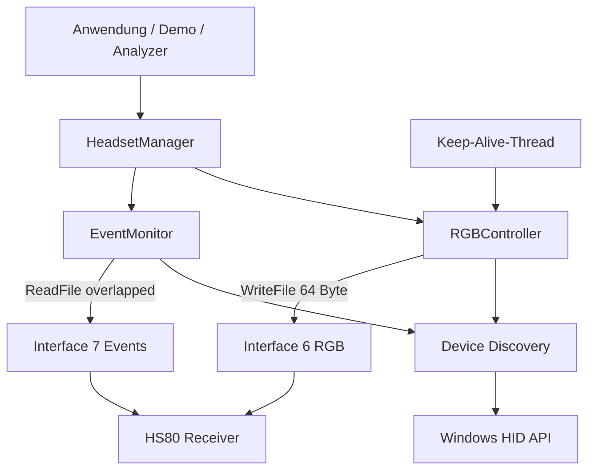
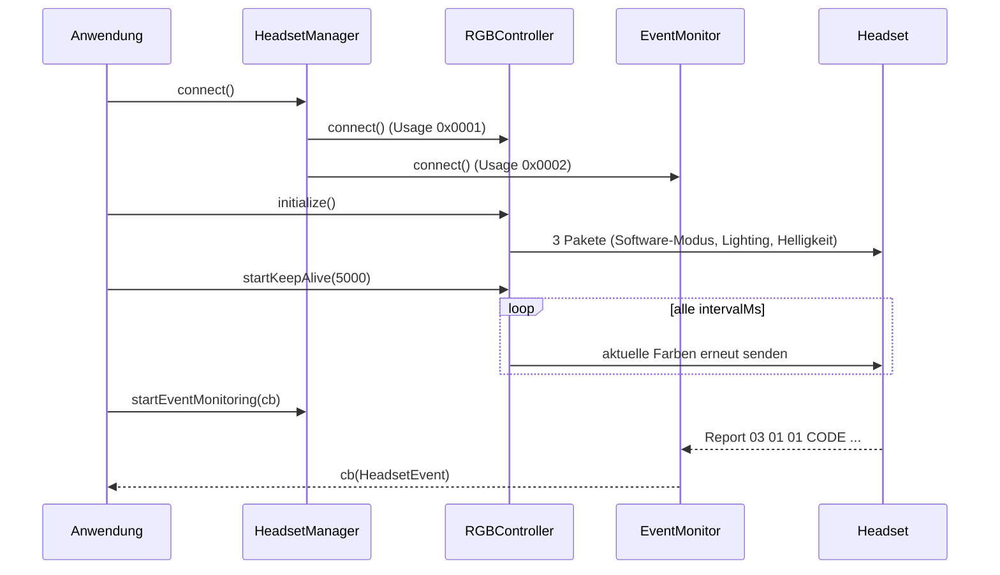

# Architektur

[Zurück zur README](../README.md)

## Überblick

Die Bibliothek (Namespace `HS80`) kommuniziert über die Windows-HID-API (SetupAPI + `CreateFile`/`ReadFile`/`WriteFile`) mit dem HS80-Receiver. Das Headset stellt mehrere HID-Interfaces bereit; relevant sind zwei auf Usage Page `0xFF42`.

| Interface | Usage | Zweck |
|---|---|---|
| Interface 6 | 0x0001 | RGB-Kommandos (Schreiben) |
| Interface 7 | 0x0002 | Events (Lesen, überlappend/asynchron) |

## Komponenten

| Komponente | Aufgabe |
|---|---|
| Device Discovery (`enumerateDevices`, `findDeviceByUsage`) | Listet HID-Geräte, liest VID/PID, Usage Page/Usage, Hersteller und Produktstring |
| `RGBController` | Software-Modus, Farben, Zonen, Helligkeit, Effekte, Keep-Alive-Thread |
| `EventMonitor` | Lese-Thread mit Overlapped I/O, ruft Callback mit `HeadsetEvent` auf |
| `HeadsetManager` | High-Level-Fassade, verbindet beide Interfaces |
| `HeadsetEvent` | Dekodierung von Mute, Akku, Ladestatus |
| Demo / Analyzer | Konsolenprogramme auf Basis der Library |

## Datenfluss

## Protokoll (aus dem Code abgeleitet)

Ausgehend (64 Byte, ohne Report-ID-Prefix): Byte 0 = `0x02`, Byte 1 = Modus (`0x09` Wireless, `0x08` Wired).

| Zweck | Bytes 2..6 |
|---|---|
| Software-Modus an | `01 03 00 02` |
| Hardware-Modus | `01 03 00 01` |
| Lighting-Endpoint öffnen | `0D 00 01` |
| Helligkeit | `01 02 00 lo hi` (0-1000, Little Endian) |
| Farben | `06 00 09 00 00 00`, ab Byte 8: R(logo,power,mic), G(...), B(...) |

Eingehend: `03 01 01 <Code> 00 <Wert> [<Wert hi>]`.

| Code | Bedeutung |
|---|---|
| 0xA6 | Mute (Byte 5: 0x01 stumm, 0x00 aktiv) |
| 0x0F | Akku (16-bit LE in Byte 5-6, Wert/10 = %) in `HS80/HS80_Library.h` |
| 0x10 | Ladestatus (Library: 0x01 = lädt; `bak/HS80.cpp`: 0x01 Start, 0x02 Ende) |

## Threads

- Keep-Alive-Thread: sendet periodisch die zuletzt gesetzten Farben; Schutz über `CRITICAL_SECTION`.
- Read-Thread des EventMonitor: Warte-Timeout 1 s, bricht dann `CancelIo` ab und liest neu.
- Callbacks laufen im Read-Thread.
